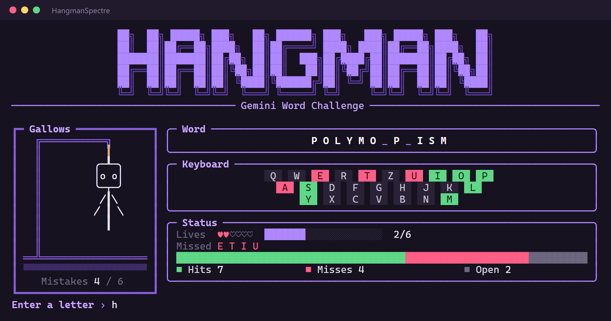
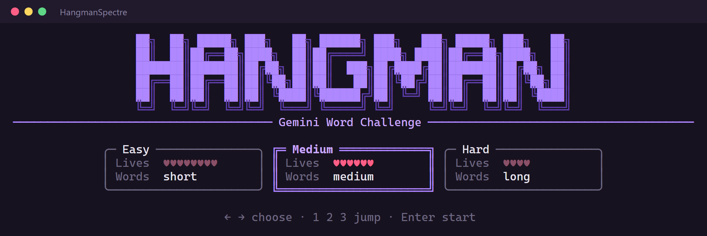
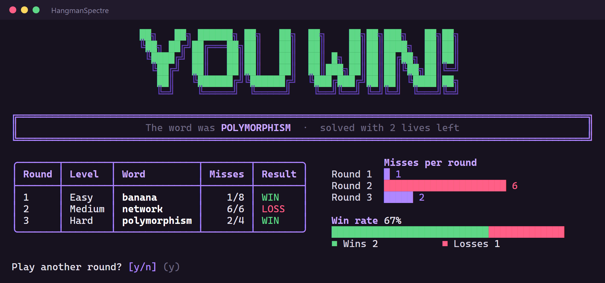
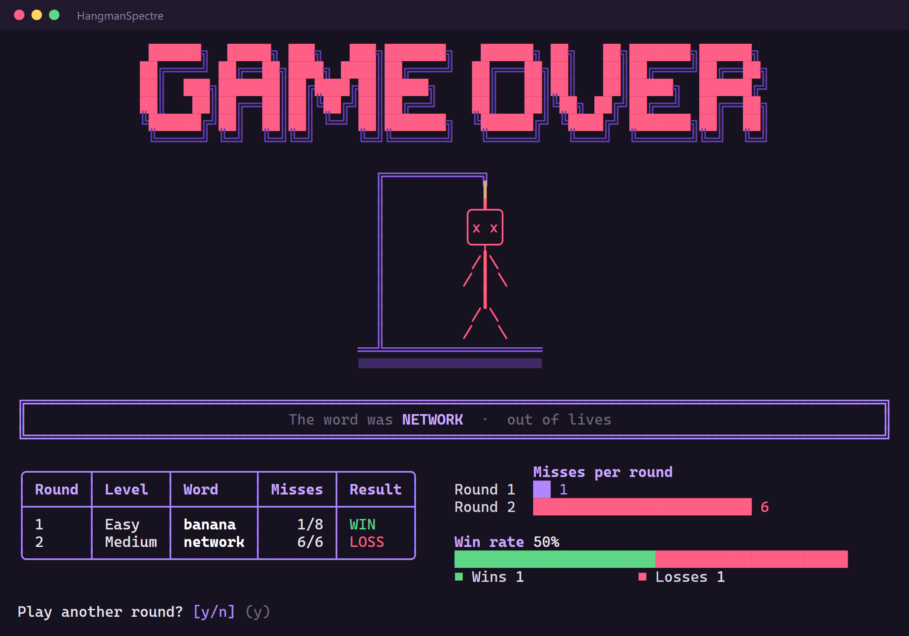

# Hangman Spectre

[](https://dotnet.microsoft.com/)
[](https://docs.microsoft.com/dotnet/csharp)
[](https://spectreconsole.net/)

## Preview



| Choose difficulty | Win |
| --- | --- |
|  |  |

| Game over |
| --- |
|  |


Short description
-----------------
A console-based Hangman game using Spectre.Console for the UI. Word generation can be provided via a Gemini API; the API key is loaded from configuration.

Key features
------------
- Spectre.Console UI in violet: block-letter titles, difficulty cards, live progress while loading, side-by-side game layout with an on-screen keyboard, round history table and charts
- Layout adapts to the console window size

Prerequisites
-------------
- .NET 10 SDK installed
- Optional: a valid Gemini API key (required if you want external word generation)

Configuration
-------------
Configuration is read with the following priority:

1. HangmanSpectre/appsettings.json (key: `Gemini:ApiKey`)
2. Environment variable `Gemini__ApiKey`
3. Local file `HangmanSpectre/gemini.key` (optional)

Example appsettings.json
```json
{
  "Gemini": {
	"ApiKey": "REPLACE_WITH_YOUR_API_KEY"
  }
}
```

Run
---
From the solution or project folder run:

dotnet run --project HangmanSpectre/HangmanSpectre.csproj

Architecture (brief)
--------------------
- Spectre.Console for the UI
- Generic Host (Microsoft.Extensions.Hosting) + DI
- GeminiWordService reads configuration via IConfiguration
- HangmanGame orchestrates game logic and UI

Troubleshooting
---------------
- If the program fails on startup due to a missing API key: check appsettings.json, create `gemini.key` or set the `Gemini__ApiKey` environment variable.
- Configuration files are copied to the output folder (CopyToOutputDirectory). If you run from a different folder, ensure files are available in the app output directory.
